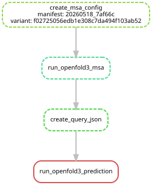
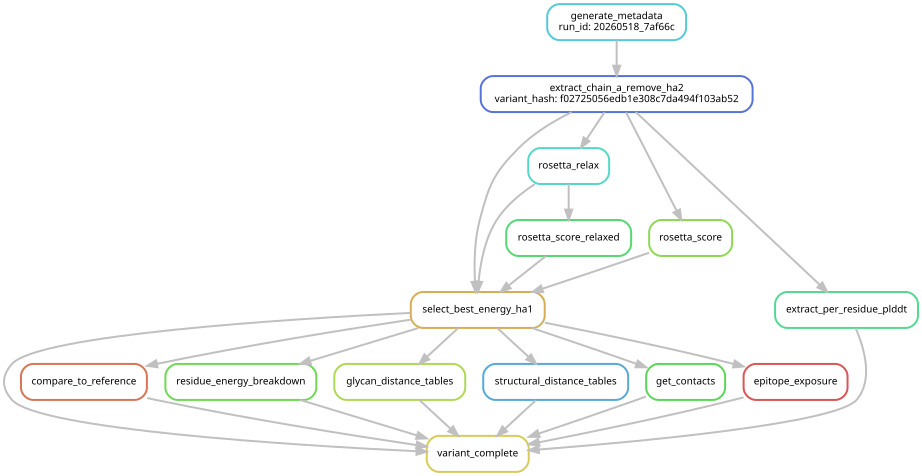

# MODPRO

## MOD-eling PRO-teins Pipeline

The MODPRO pipeline was developed by the CDC's Influenza Division to analyze AlphaFold-predicted structures for antigenic drift of influenza hemagglutinin proteins. 
Viral strain fitness is predicted in terms of antigenic drift using a fitness landscape model (see repo referenced below) relative to a user-selected vaccine reference. It uses open-source programs along with custom CDC code. With minor tweaking, this program is usable by external partners but can also be run on the CDC cluster. The generated datasets offer insights into the evolutionary fitness of viral strains without the need for in-house sequencing or propagation efforts as long as high-quality sequencing is publicly available. The pipeline simplifies and visualizes complex sequence surveillance data, aiding leadership in making informed decisions regarding public health. It can be used to generate new training datasets and perform _ad hoc_ comparisons of biophysical characteristics between individual isolates or reference strains.

Structural bioinformatics pipeline orchestrated by a weekly (Mondays) NiFi cron job that queries `ref_sys` database `model_priority` table to identify high-priority HA variants not yet predicted by Openfold3 but targeted for experimentation by the laboratory. Pipeline then generates a run manifest after checking HDFS for duplicates and logs metadata before publishing manifest to GWA, triggering Snakemake structural prediction pipeline. The planned update includes database cleanup, automated variant processing, enhanced RBS epitope analysis with sialic acid binding prediction feature, and a strategic shift to HA1-focused relaxation and analytics. 

For each variant, amino acid sequences are retrieved from CDP, converted to fasta files, submitted for MSA generation, OpenFold3 structure prediction, and phenotypic analyses [glycosylation distance calculation, RBS epitopes, structural distance calculations etc] all the while capturing QC metrics such as full-length pLDDT, logging execution and CDP publication status. Full-length structures are archived, followed by HA1-focused processing that includes chain- and domain- trimming, Rosetta scoring, RMS/MaxSub evaluation, biophysical relaxation, with decision points enforcing QC thresholds and selecting improved structures based on logged improvement of energy score and RMSD. All intermediate and final metrics recorded in `protein_modeling`. `logging` and `qc` tables. NiFi handles observability and quality control by ingesting checkpointed outputs from Snakemake, publishing validated files to HDFS, and writing SQL metadata and run results. The pipeline distinguishes clearly between compute and publication states, enabling robust retry, auditability, and reliable end-to-end processing.

The python script `monitor_manifests.py` continuously watches for new Monday and Thursday manifest files and launches Snakemake workflow automatically.
The monitor polls both directories every 10 seconds.

Usage for monitoring script:
```bash
tmux new -s modpro-monitor
cd /scicomp/groups/modpro
python monitor_manifests.py | tee monitor.log
```
detach from session:
```bash
Ctrl-b d
```
reattach:
```bash
tmux attach -t modpro-monitor
```
kill:
```bash
Ctrl-c
```

Monday/OpenFold3 pipeline is triggered when Nifi generates a manifest ending in .csv: [Nifi Monday pipeline](https://cdp-util-02.biotech.cdc.gov:8443/nifi/?processGroupId=9cb93692-18d9-1618-a24c-d1d7fc23c357&componentIds=#/process-groups/881e3d30-341b-1bdc-a753-bbe492b171d4) pulls variant hashes from REFSYS and generates manifest, posted to `/scicomp/groups/modpro/manifests` triggering openfold3 job managed by snakemake.

Thursday/Rosetta pipeline triggered by Nifi generating a manifest ending in .tsv automatically every Thursday in: `/scicomp/groups/modpro/manifests/rosetta_runs/`. [Nifi Thursday pipeline](https://cdp-util-02.biotech.cdc.gov:8443/nifi/?processGroupId=9cb93692-18d9-1618-a24c-d1d7fc23c357&componentIds=#/process-groups/ed5534dd-55d1-1bce-bb46-805f7879ce50) runs characterization and copies parquet file output to the staging area `/scicomp/groups/ID-VSDB/GAT/protein_modeling/staging` for pickup by the Nifi [protein modeling post pipeline](https://cdp-util-02.biotech.cdc.gov:8443/nifi/?processGroupId=9cb93692-18d9-1618-a24c-d1d7fc23c357&componentIds=#/process-groups/416d35ee-136d-164d-8b00-8c9645776218/Processor/d0c93509-42e2-1dd7-a766-d5259d7deeb8)

Protein models are prioritized in a SQL statement that writes to the `protein_modeling.model_priority` table. The SQL can be found in this repo under `model_priority.sql` and updates from the Nifi Mondays pipeline on a Monday cron at 7am. The top 10 variant hashes that are not already modeled according to PASS in the `protein_modeling.logging` and `protein_modeling.qc` tables. This SQL can be found in this repo under `variant_pull.sql` and is run Mondays at 8am as part of the Monday Nifi pipeline.

DAGs for the Monday/Thursday Snakemake pipelines:

## Monday's DAG


## Thursday's DAG



```
.
├── LICENSE
├── README.md
├── Snakefile-mondays
├── Snakefile-thursdays
├── config.yaml
├── manifests
│   └── <date>_<uuid>.csv
├── monitor_manifests.py
├── notes_on_design
├── openfold3
│   ├── jsons
│   ├── fastas
│   ├── msas
│   │   └── <variant_hash>
│   │       └── msa.done
│   ├── check_gpu.sh
│   ├── checkpoints
│   ├── openfold-3
│   ├── openfold3.yml
│   ├── runner.yml
│   ├── runner_lowmem.yml
├── refs
│   ├── B_HA_reference.pdb
│   ├── B_HA_seasonal.pdb
│   ├── H1_HA_reference.pdb
│   ├── H1_HA_seasonal.pdb
│   ├── H3_HA_reference.pdb
│   └── H3_HA_seasonal.pdb
├── results
│   ├── <date>_<uuid>
│   │   └── openfold3
│   │   |    └── <date>_<uuid>_<variant_hash>
│   │   |       └── prediction
│   │   |            ├── <variant_hash>
│   │   |            │   └── seed_42
│   │   |            │       ├── <variant_hash>_seed_42_sample_1_confidences.json
│   │   |            │       ├── <variant_hash>_seed_42_sample_1_confidences_aggregated.json
│   │   |            │       ├── <variant_hash>_seed_42_sample_1_model.pdb
│   │   |            │       └── timing.json
│   │   |            └── structure.done
│   |   └── rosetta_ready
│   |   |   └── <date>_<uuid>_<variant_hash>
|   |   |       └── <variant>.pdb
│   |   └── rosetta
│   |   |    └── <date>_<uuid>_<variant_hash>
|   |   |        └── relax
|   |   |           └── <variant>.pdb
│   |   └── characterization
│   |       └── <date>_<uuid>_<variant_hash>
|   |           └── fitscape
|   |           |   └── <variant_hash>.txt
|   |           └── glycosylation_distance
|   |           |   └── <variant_hash>.txt
|   |           └── epitope_calculation
|   |               └── <variant_hash>.txt
│   └── logging_qc
│        └── <date>_<uuid>
│             ├── <variant_hash>.relax.log
│             ├── <variant_hash>.relaxed_score.log
│             └── <variant_hash>.relaxed_score.sc
└── scripts
    ├── best_HA.py
    ├── csv_to_parquet.py
    ├── dataframe.py
    ├── dataframe_per_res.py
    ├── df_str_dist.py
    ├── epitope_exposure_diff.py
    ├── get_static_contacts.py
    ├── getcontacts_df.py
    ├── glyc.py
    ├── plddt.py
    └── trim_HA1.py
```
staging directory: `/scicomp/groups/ID-VSDB/GAT/protein_modeling/staging` 


`protein_modeling.logging_qc.publication_status` table in CDP tracks data delivery of the MSA, QC, Rosetta, Glycosylation Distance, Fitscape, and Dockings (in prog) as a binary PASS/FAIL.

Pass/Fail defined as: 
 - MSA- if exists ```/results/<date>_<uuid>/openfold3/msas/<variant_hash>/msa.done```
       else FAIL
 - Structure complete - if exists   `/results/<date>_<uuid>/openfold3/prediction/<variant_hash>/structure.done`
        else FAIL
 - QC - `/results/<date>_<uuid>/rosetta_ready_dir/<variant>.pdb`
       else FAIL
 - Rosetta- /results/<date>_<uuid>
       else `tail <date>_<uuid>/<variant_hash>.relax.log`
 - Glycosylation Distance if exists `/results/<date>_<uuid>/characterization/<date>_<uuid>_<variant_hash>/glycosylation_distance/<variant_hash>.txt` 
       else FAIL
 - Fitscape if exists `/results/<date>_<uuid>/characterization/<date>_<uuid>_<variant_hash>/fitscape/<variant_hash>.txt`
       else FAIL
- Dockings (in prog) if exists `/results/<date>_<uuid>/characterization/<date>_<uuid>_<variant_hash>/epitope_calculation/<variant_hash>.txt`
       else FAIL

## Weekly Variant Structural Prediction Pipeline Flow
Updated Process Flow:
Automated SQL queries against ref_sys database to identify high-priority variants (deduplication checks against existing protein_modeling entries)  
Submission to OpenFold3 for structure prediction
HA1 domain extraction, optimization by rosetta relaxation protocols for energy minimization (energy optimization enforcement for relaxed structures)
Comprehensive logging and audit trails, error handling with retry mechanisms

## Automated Variant Processing Pipeline
REFSYS ensures that limited laboratory resources (60-100 HI tests and 10-15 HINT tests per week per subtype) are allocated to specimens that provide optimal surveillance coverage.
Inference balances the need for comprehensive coverage with statistical rigor, ensuring that well-characterized variants receive inferred results while directing testing resources toward variants that need additional characterization or represent emerging threats.

## Enhanced RBS Epitope Analysis
Epitope prediction tool represents integration of structural biology and immunology principles. The 15 Angstrom distance criterion is large enough to capture the full span of conformational epitopes while remaining within the physical reach of antibody binding domains. Inclusion of both surface accessibility and glycosylation analysis filter out sites without antibody accessibility. The centroid-based approach is especially valuable for RBS analysis since this region is the most functionally and immunologically important site for antigenic drift. 

## Sialic Acid Binding Site Analysis: <dev mode>
Optimized Boltzmann scoring, benchmarks
Database Schema Optimization: Remove deprecated tables and implement new analytical structures and optimize join strategies 
HA1 Domain Focus: Transition from full HA to HA1-specific modeling

Targeted Tables for Removal:
unrelaxed_pdb_data - Contains unprocessed structural data
<convert to HA1 only, pLDDT average for whole and HA1>
secondary_structure - Legacy secondary structure annotations
test - Development/testing artifacts

## Updates to NDW Tables:  
`protein_modeling.rbs_epitope`- calculation of distance to receptor binding site in Angstroms and surface accessibility calc, for use in determining whether epitope footprint maps are predicted to change. 

`protein_modeling.plddt` - includes per-residue data on Openfold3 confidence scores

`protein_modeling.logging` - parses log files for completed steps, if all successful, `status` = SUCCESS otherwise the variant is FAILED and rerun.

`protein_modeling.qc` - sanity check summary for variants passed through pipeline, collates data from energy scores before and after Rosetta relaxation, reports RMS and Maxsub values relative to subtype-specific variants, average pLDDT for the HA1. 

Sialic acid binding predictions in dev [off mode until benchmarks passed], see dokken repo for a pilot example. 

## HA1-Specific Modeling
Transitioning from full HA to HA1-focused analysis represents a strategic shift toward more targeted and efficient modeling because of increased functional relevance: HA1 contains the receptor binding domain and primary antigenic sites; better evolutionary focus as most antigenic drift occurs in the HA1 globular head domain. Full PDB will be stored in the database for ad hoc analysis. Critical receptor binding and neutralization sites are HA1-localized and enhanced accuracy better folding predictions for smaller, more stable domains.

## Computational Efficiency
Smaller domain size enables higher resolution analysis as well as containing the region with the highest pLDDT values (highest confidence) for more reliable analysis.

## This pipeline generates biophysical information on each structure and includes the following, in addition to more granular features :

## Qualitative Metrics
- Rosetta Energy Scores, total and per-residue (a measure of relative stability of protein in question)
- Root mean square difference - RMS and MaxSub (a scoring of the deviation in alignment between the protein and a reference structure)
- Relative surface accessibility per residue

##  Biophysical Properties Calculators (CDC-generated)
- Glycosylation distance calculator
- RBS epitopes prediction calculator
- Structural distance calculator for generating fitness landscapes <https://git.biotech.cdc.gov/hxa6/fit_landscape>

## Full Workflow Diagram

```mermaid

flowchart TB
    %% =====================================================
    %% STYLES
    %% =====================================================
    classDef nifi fill:#EAF2FF,stroke:#2F6FED,stroke-width:1.5px,color:#1F2937;
    classDef model fill:#ECFDF3,stroke:#1F9D63,stroke-width:1.5px,color:#1F2937;
    classDef analytic fill:#F4FDF7,stroke:#159A5B,stroke-width:1.5px,color:#1F2937;
    classDef store fill:#FFF4E8,stroke:#D97706,stroke-width:1.5px,color:#1F2937;
    classDef decision fill:#FFFBEA,stroke:#CA8A04,stroke-width:1.5px,color:#1F2937;
    classDef report fill:#F3F0FF,stroke:#7C3AED,stroke-width:1.5px,color:#1F2937;

    %% =====================================================
    %% ORCHESTRATION
    %% =====================================================
    subgraph A["Structural Bioinformatics Workflow"]
        direction LR
        A1["Weekly Nifi Cron"]
        A2["ExecuteSQL<br/>Pull top ref_sys variants"]
        A3["Weekly REFSYS Pull<br/>Normalize and deduplicate"]
        A4["Post to GWA"]
        A5["Post to HDFS"]
        A6["Trigger Snakemake workflow from new GWA file"]
        A1 --> A2 --> A3 --> A4 --> A5 --> A6
    end

    %% =====================================================
    %% MODELING
    %% =====================================================
    subgraph B["Snakemake Workflow Part1"]
        direction LR

        subgraph B1["Input Configuration"]
            direction TB
            B1a["Ingest sequence"]
            B1b["Create seq.fasta"]
            B1c["Create msa_config.json"]
            B1d["Create seq_name.json"]
            B1a --> B1b --> B1c --> B1d
        end

        subgraph B2["Prediction"]
            direction TB
            B2a["Run MSAs"]
            B2b["Run OpenFold3"]
            B2c["Report HA1 pLDDT"]
            B2d{"QC threshold met?"}
            B2e["Re-run prediction"]
            B2a --> B2b --> B2c --> B2d
            B2d -- No --> B2e --> B2a
        end

        subgraph B3["HA1 Processing and Selection"]
            direction TB
            B3a["Remove B and C chains and HA2"]
            B3b["Archive full-length PDB to GWA"]
            B3c["Rosetta score for HA1"]
            B3d["RMS and MaxSub for HA1"]
            B3e["Rosetta relax"]
            B3f["Retain higher-quality HA1<br/>based on improved RMSD"]
            B3a --> B3b --> B3c --> B3d --> B3e --> B3f
        end

        B1d --> B2a
        B2d -- Yes --> B3a
    end

    %% =====================================================
    %% ANALYTICS
    %% =====================================================
    subgraph C["Snakemake Workflow Part 2"]
        direction LR
        C1["Glycosylation distance"]
        C2["GetContacts"]
        C3["FITscape"]
        C4["Centroid prediction and RBS residues"]
        C1 --> C2 --> C3 --> C4
    end

    %% =====================================================
    %% OBSERVABILITY / DELIVERY
    %% =====================================================
    subgraph D["Observability and Delivery"]
        direction LR
        D1["Logging"]
        D2["Run reporting"]
        D3["NiFi PostHDFS"]
        D4["Write SQL metadata and results"]
        D5["Summary outputs"]
        D1 --> D2 --> D3 --> D4 --> D5
    end

    %% =====================================================
    %% STORAGE
    %% =====================================================
    E1["GWA"]
    E2["HDFS"]
    E3["SQL Metadata and Results"]

    %% =====================================================
    %% FLOW LINKS
    %% =====================================================
    A4 --> E1
    A5 --> E2
    A6 --> B1a
    B3b --> E1
    B3f --> C1
    C4 --> D1
    D3 --> E2
    D4 --> E3
    D5 --> E2

    %% =====================================================
    %% CLASS ASSIGNMENTS
    %% =====================================================
    class A1,A2,A3,A4,A5,A6,D3,D4 nifi;
    class B1a,B1b,B1c,B1d,B2a,B2b,B2c,B2e,B3a,B3b,B3c,B3d,B3e,B3f model;
    class C1,C2,C3,C4 analytic;
    class E1,E2,E3 store;
    class B2d decision;
    class D1,D2,D5 report;
```



## Privacy Standard Notice

This repository contains only non-sensitive, publicly available data and information. All material and community participation is covered by the[Disclaimer](https://github.com/CDCgov/template/blob/main/DISCLAIMER.md) and [Code of Conduct](https://github.com/CDCgov/template/blob/main/code-of-conduct.md). For more information about CDC's privacy policy, please visit <http://www.cdc.gov/other/privacy.html>.

## Records Management Standard Notice

This repository is not a source of government records, it is to increase collaboration and collaborative potential. All government records will be published through the [CDC web site](http://www.cdc.gov/).

## Additional Standard Notices

Please refer to [CDC's Template Repository](https://github.com/CDCgov/template) for more information about [contributing to this repository](https://github.com/CDCgov/template/blob/main/CONTRIBUTING.md), [public domain notices and disclaimers](https://github.com/CDCgov/template/blob/main/DISCLAIMER.md), and [code of conduct](https://github.com/CDCgov/template/blob/main/code-of-conduct.md).

## Attributions, License, and Limitations

## Limitations

This code is intended for external users and relies on code developed specifically for this purpose or from open source or publicly available code (getcontacts, Rosetta). This program is intended to create data that can be used for creating machine learning datasets, and is not intended to predict antigenic drift on its own or to any specific degree of confidence. Any downstream use of this data is the responsibility of the user and CDC and its affiliates take no responsibility for purposes beyond what is contained herein.

## License Standard Notice

The repository utilizes code licensed under the terms of the Apache Software License and therefore is licensed under ASL v2 or later. This source code in this repository is free: you can redistribute it and/or modify it under the terms of the Apache Software License version 2, or (at your option) any later version. This source code in this repository is distributed in the hope that it will be useful, but WITHOUT ANY WARRANTY; without even the implied warranty of MERCHANTABILITY or FITNESS FOR A PARTICULAR PURPOSE. See the Apache Software License for more details.

## Contributing Standard Notice

Anyone is encouraged to contribute to the repository by forking and submitting a pull request. (If you are new to GitHub, you might start with a basic tutorial.) By contributing to this project, you grant a world-wide, royalty-free, perpetual, irrevocable, non-exclusive, transferable license to all users under the terms of the Apache Software License v2 or later.

All comments, messages, pull requests, and other submissions received through CDC including this GitHub page may be subject to applicable federal law, including but not limited to the Federal Records Act, and may be archived. Learn more at <http://www.cdc.gov/other/privacy.html>.

## Public Domain Standard Notice

This repository constitutes a work of the United States Government and is not subject to domestic copyright protection under 17 USC § 105. This repository is in the public domain within the United States, and copyright and related rights in the work worldwide are waived through the [CC0 1.0 Universal public domain dedication](https://creativecommons.org/publicdomain/zero/1.0/). All contributions to this repository will be released under the CC0 dedication. By submitting a pull request you are agreeing to comply with this waiver of copyright interest.

## Points of contact

Maintainer Nicole Paterson (CDC) @patersonnicole <qxa4@cdc.gov>
Developer Nicholas Kovacs (CDC) @nicholasakovacs <nattila.kovacs@gmail.com>
Developer Brian Mann (CDC) @mannbrian <ytw4@cdc.gov>
